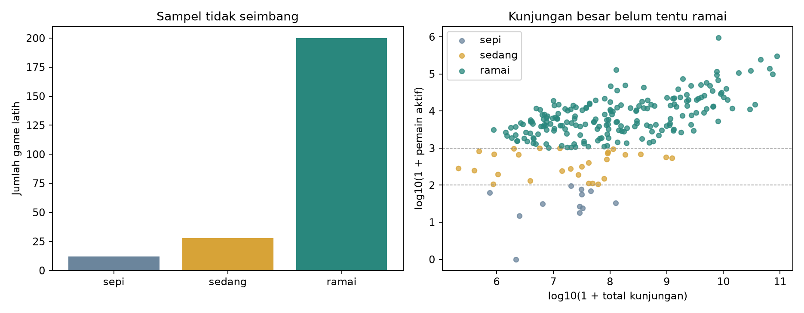
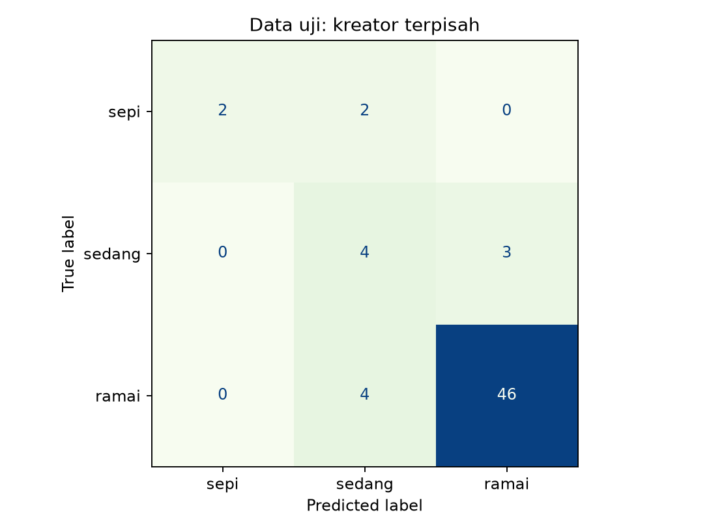

# Roblox Crowd Prediction

**Apakah game dengan banyak kunjungan sepanjang masa masih ramai dimainkan?**

Proyek machine learning ini memperkirakan tingkat keramaian game Roblox dari total kunjungan, favorit, umur game, dan kapasitas server. Data diambil langsung dari API publik Roblox pada **16 Oktober 2026, sekitar 09.31–09.33 WIB**. Katalog rodict hanya dipakai untuk menentukan daftar game yang diperiksa.

Contoh alur: statistik sebuah game → model yang belajar dari game lain → prediksi **sepi**, **sedang**, atau **ramai**.

Ini eksperimen klasifikasi dari satu snapshot, bukan ramalan pemain besok. Jika ingin mengetahui pemain aktif sebenarnya, baca langsung statistik Roblox; tujuan ML di sini adalah menguji hubungan statistik historis dengan keramaian saat pengamatan.

## Hasil utama

| Ukuran evaluasi | Random Forest terpilih | Tebak semua game ramai |
|---|---:|---:|
| Akurasi pada 61 game uji | 85,25% | 81,97% |
| Macro-F1 pada data uji | 0,6888 | 0,3003 |
| Recall sepi | 50,00% (2/4) | 0% |
| Recall sedang | 57,14% (4/7) | 0% |
| Recall ramai | 92,00% (46/50) | 100% |

Model benar pada 52 dari 61 game uji. Peningkatan akurasi atas tebakan mayoritas hanya 3,28 poin persentase. Macro-F1 memberi gambaran tambahan karena tebakan mayoritas mengabaikan dua kelas kecil. Hasil sepi dan sedang masih lemah serta tidak stabil: data uji hanya berisi empat dan tujuh contoh untuk kelas tersebut.




## Mengapa proyek ini dibuat?

Kunjungan adalah total akumulasi, sedangkan pemain aktif adalah orang yang sedang berada di game pada saat pengamatan. Game lama bisa memiliki banyak kunjungan tetapi sedikit pemain saat ini. Eksperimen membandingkan model dengan informasi kunjungan dan umur saja terhadap model yang juga mendapat favorit dan kapasitas server.

Pada validasi silang data latih, Random Forest dengan profil lengkap mendapat macro-F1 **0,5850**, dibanding **0,5384** untuk Random Forest dengan kunjungan dan umur saja. Selisih yang teramati ini bukan bukti bahwa favorit menyebabkan pemain bertambah.

## Data dan definisi kelas

Terdapat **301 game**, dari **298 kreator**, setelah dua entri tidak tersedia dikeluarkan. Kelas tidak seimbang: **16 sepi, 35 sedang, 250 ramai**. Tidak ada nilai kosong pada empat input model dan tidak ada universe ID ganda pada data yang dipakai.

| Pemain aktif saat pengambilan | Label |
|---|---|
| 0–99 | sepi |
| 100–999 | sedang |
| 1.000 atau lebih | ramai |

Batas ini ditetapkan untuk eksperimen pendidikan sebelum pemodelan; bukan kategori resmi Roblox. `playing` hanya dipakai untuk membuat jawaban yang benar dan mengevaluasi prediksi, **tidak menjadi input model**.

| Input | Makna |
|---|---|
| `visits` | Total kunjungan, bukan jumlah pemain unik |
| `favorites` | Jumlah favorit publik |
| `age_days` | Umur game dalam hari sejak dibuat, dihitung pada waktu pengambilan |
| `max_players` | Kapasitas satu server, bukan total pemain yang sedang bermain |

Fitur turunan `favorites_per_1000_visits = 1000 × favorites / max(visits, 1)`. Semua fitur numerik memakai `log1p` untuk mengurangi perbedaan skala, kemudian standardisasi di dalam Pipeline. Rasio favorit bukan jumlah pengguna unik atau metrik retensi.

## Menjalankan proyek

Gunakan **Python 3.12**. Jalankan perintah dari folder yang berisi README ini. Data snapshot sudah disertakan sehingga pelatihan tidak membutuhkan akses Roblox atau akun Roblox.

```powershell
python -m venv .venv
.venv\Scripts\python.exe -m pip install -r requirements.txt
.venv\Scripts\python.exe src/train.py
.venv\Scripts\python.exe demo.py
```

Di Windows perintah tersebut tidak membutuhkan aktivasi lingkungan atau perubahan execution policy. Pada macOS/Linux gunakan `.venv/bin/python` sebagai pengganti `.venv\Scripts\python.exe`.

Demo menyediakan pilihan memakai contoh game nyata atau mengisi empat angka sendiri. Tidak ada password, cookie Roblox, atau API key yang dibutuhkan. Prediksi dapat salah, termasuk untuk contoh nyata.

Untuk memprediksi beberapa game dari CSV:

```powershell
.venv\Scripts\python.exe src/predict.py examples/games.csv results/example_predictions.csv
```

CSV minimal memiliki empat kolom input di atas. Nama game boleh ditambahkan sebagai keterangan, tetapi tidak dipakai model. Kolom `outside_training_range` menandai input di luar rentang data latih; ini bukan jaminan bahwa input dalam rentang pasti akurat.

## Rancangan eksperimen

1. Ambil ID game dari ekspor rodict. Ambil ulang seluruh statistik yang dipakai dari `games.roblox.com/v1/games` dalam batch maksimum 50 ID.
2. Periksa berkas sumber terhadap hash di manifest, nilai kosong, angka tidak valid, duplikasi ID, serta entri yang dibatasi/tidak tersedia. Simpan audit.
3. Sisihkan **61 game uji** dan gunakan **240 game latih**. Pemisahan memakai `StratifiedGroupKFold`, seed 42, lipatan pertama dari lima lipatan. Kreator yang sama tidak muncul di kedua bagian.
4. Buat EDA substantif dari data latih. Empat lipatan validasi pada data latih juga dipisahkan berdasarkan kreator.
5. Bandingkan tebakan mayoritas, Logistic Regression, Decision Tree, dan Random Forest pada dua kelompok fitur. Model selain tebakan mayoritas memakai bobot kelas seimbang. Grid parameter berada di `src/train.py`.
6. Pilih kombinasi fitur dan parameter berdasarkan rata-rata macro-F1 validasi tertinggi. Evaluasi model terpilih pada data uji; evaluasi tebakan mayoritas sebagai pembanding yang ditetapkan sejak awal.

`playing`, ranking berdasarkan pemain, puncak pemain sepanjang masa, status aktif/mati, dan perkiraan pendapatan tidak digunakan sebagai input. Metrik tersebut dapat memberi petunjuk langsung atau turunan tentang target sehingga perbandingannya menjadi menyesatkan.

Skor CV terbaik dipengaruhi pencarian parameter dan bukan estimasi independen. Simpangan baku antarlipatan bukan interval kepercayaan. Data uji tidak dipakai untuk memilih model atau mengubah batas kelas.

## Struktur repository

```text
roblox-crowd-prediction/
├── README.md
├── MULAI_DI_SINI.md           penjelasan proyek untuk pemula
├── demo.py                    demo interaktif di terminal
├── requirements.txt
├── LICENSE                    lisensi kode proyek
├── data/
│   ├── README.md              sumber dan arti kolom
│   ├── raw/                   respons API asli dan manifest
│   └── processed/games.csv    data bersih, label, dan pembagian
├── src/
│   ├── data.py                aturan data dan fitur
│   ├── fetch_data.py          kolektor eksplisit, tidak berjalan saat latihan
│   ├── train.py               EDA, validasi, pelatihan, evaluasi
│   ├── predict.py             prediksi input CSV
│   └── build_notebook.py      membuat notebook pembaca hasil
├── notebooks/                 eksplorasi dan pembacaan hasil
├── models/                    model yang dibuat saat pelatihan
├── results/                   audit, grafik, skor, prediksi, kesalahan
└── tests/                     pemeriksaan label, kebocoran, dan konsistensi
```

Model biner diabaikan oleh Git dan dibuat kembali lewat pelatihan. Hanya muat berkas model yang dipercaya. Notebook pendamping membaca hasil eksperimen; sumber pelatihan lengkap berada di `src/train.py`.

## Pemeriksaan

```powershell
.venv\Scripts\python.exe -m unittest discover -s tests -v
.venv\Scripts\python.exe demo.py --example
```

Pemeriksaan menguji batas label, penolakan input tidak valid, pemisahan kreator, tidak masuknya target ke fitur, serta kecocokan prediksi model tersimpan dengan metrik yang dilaporkan.

## Batas penggunaan

- Sampel kecil berasal dari katalog pelacak game; bukan sampel acak seluruh Roblox. Game ramai sangat mendominasi.
- Statistik diambil dalam beberapa batch selama sekitar dua menit, bukan pada satu detik persis. Timestamp adalah waktu penyimpanan respons, bukan jaminan waktu pengukuran internal Roblox.
- Pembagian berdasarkan kreator mengurangi kemiripan antargame yang diuji, tetapi hasil ini masih berasal dari satu rentang waktu. Belum ada pengujian lintas hari, negara, acara game, atau musim liburan.
- Model memperkirakan keadaan game yang sudah memiliki statistik. Belum diuji untuk game baru sebelum dirilis, dan tidak memprediksi keberhasilan masa depan, kualitas game, atau pendapatan.
- Terutama pada kelas kecil, beberapa kesalahan saja dapat mengubah skor secara besar. Jangan menganggap akurasi 85,25% sebagai jaminan pada semua game Roblox.

## Sumber dan pengambilan ulang

- [Roblox Games API](https://create.roblox.com/docs/cloud/reference/domains/games): statistik game yang dipakai dalam model.
- [rodict Export API](https://rodict.vercel.app/api-docs): daftar universe ID awal; statistik turunan/estimasi rodict tidak dipakai dalam model.
- [StratifiedGroupKFold](https://scikit-learn.org/stable/modules/generated/sklearn.model_selection.StratifiedGroupKFold.html): pemisahan kelompok kreator.

URL permintaan, hash SHA-256, ID tidak tersedia, serta waktu setiap respons terdapat di `data/raw/manifest.json`. Beri atribusi kepada Roblox dan rodict ketika memakai snapshot ini. Lisensi MIT proyek berlaku untuk kode buatan proyek; tidak mengalihkan hak atas konten dan merek pihak ketiga.

Untuk mengambil data, jalankan `python src/fetch_data.py` secara eksplisit. Kolektor memakai ulang berkas yang sudah ada. Jika ingin eksperimen pada snapshot baru, buat salinan proyek dengan folder `data/raw` baru dan kosong, lalu jalankan pengambilan dan pelatihan di sana. Skor snapshot baru dapat berbeda; jangan mencampur batch lama dan baru atau mengganti snapshot pengumpulan ini setelah membaca data uji.

## Mengumpulkan ke GitHub

Nama repository yang disarankan: **`roblox-crowd-prediction`**. Buat repository kosong, lalu unggah **isi folder proyek** ke halaman utama repository. Jangan mengunggah ZIP saja. Sertakan kode, README, dataset snapshot dan hasil. Jangan unggah `.venv`, `__pycache__`, atau model biner. Petunjuk lengkap ada di [MULAI_DI_SINI.md](MULAI_DI_SINI.md).

Proyek pendidikan independen; tidak berafiliasi dengan Roblox Corporation. Kode disusun dengan bantuan AI, sementara data dan hasil berasal dari pengambilan serta eksperimen yang dapat dijalankan ulang. Pahami alurnya dan ikuti ketentuan penggunaan AI dari mata kuliah.
